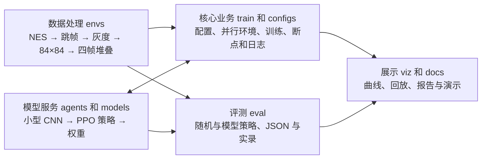

# 超级马里奥强化学习项目设计

## 需求与边界

在 Super Mario Bros. World 1-1 上训练可加载的 PPO 策略。智能体只观察游戏图像，通过七个手柄动作学习前进、跳跃和避障。训练不依赖玩家示范，评测保留随机策略作基线。CPU 可运行，硬件、训练步数、耗时和实际通关率写入实验记录。

- 开发者能用配置启动训练、查看 TensorBoard、加载模型和续训。
- 评测者能在相同关卡、种子和局数下比较随机与训练后策略，并得到 JSON 和实录。
- 验收者能在干净目录安装，复跑冒烟、训练和评测，核对训练曲线与实验记录。
- 评测采集最远距离、平均与标准差奖励、通关率、FPS 和内存峰值。最远距离目标为随机策略的三倍，平均奖励目标高于随机，训练曲线应呈上升并趋稳。约百万步的训练目标为三小时内完成，评测目标为 30 FPS，内存峰值目标为 8 GB。实际结果由 QM 核对。

## 架构

`scripts/` 提供安装和入口调用，`tests/` 按环境接口和交付流程验证。源码、配置与文档在 Git 中留痕，模型、日志和录像按交接单的位置取用。

## 选型

PPO 在采样一批轨迹后复用轨迹进行多轮更新，并通过裁剪策略概率比限制更新幅度。用 Stable-Baselines3 管理训练、存档与加载。小型 CNN 从 84×84 图像提取空间特征，四帧输入提供运动线索。游戏原始图像与录像保留 RGB，送入模型的观测按训练接口归一化。

DQN 可利用离散动作和经验回放，图像堆叠下需要额外考虑回放容量和显存或内存占用。手写启发式策略可用来定位环境异常，项目主基线采用均匀随机动作，便于说明学习前后的差异。若比较不同奖励配置，评测使用同一套计分规则。

`gym-super-mario-bros` 7.4 和 `nes-py` 8.2 提供 Python 3.11 可用的旧 Gym 后端。项目把 API 转换放在环境层，对训练与评测暴露 Gymnasium 接口。适配设计参考 [mario-ai-trainer](https://github.com/mgelsinger/mario-ai-trainer)，依赖及版本在安装后以实际输出核对。

